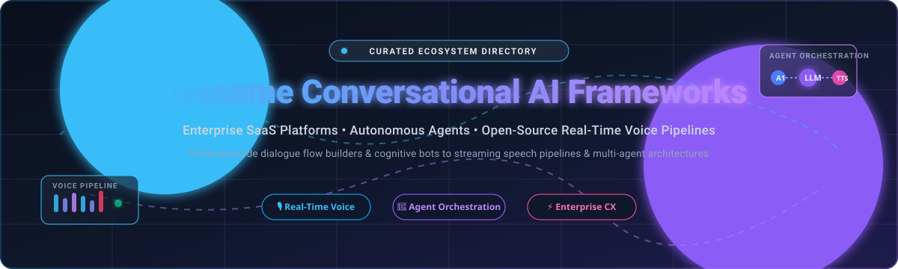

# 🤖 Awesome Conversational AI Frameworks

  <strong>Curated Directory of Enterprise SaaS Platforms, Agentic Orchestration Systems & Real-Time Voice Pipelines</strong>

  
  
  
  
  
  
  

---

## 🧭 Overview & Ecosystem Map

Welcome to **Awesome-Conversational-AI-Frameworks** — a comprehensive, production-grade guide to the modern Conversational AI ecosystem. This repository tracks cutting-edge **SaaS enterprise platforms**, **multi-agent orchestration frameworks**, **real-time voice pipelines**, and **developer-centric open-source engines**.

Whether you are architecting low-latency voice assistants with speech-to-speech models, engineering multi-agent dialogue workflows with deterministic guardrails, or building enterprise customer experience (CX) bots, this curated knowledge base details pricing tiers, trial limits, architecture models, and GitHub metrics.

---

## 📑 Table of Contents

- [📊 Sector Overview & Market Dynamics](#-sector-overview--market-dynamics)
- [☁️ SaaS/Hosted Platforms](#️-saashosted-platforms)
- [🔓 Open-Source GitHub Projects](#-open-source-github-projects)
- [🛠️ How to Contribute](#️-how-to-contribute)
- [💖 Support & Sponsorship](#-support--sponsorship)
- [📈 Star History](#-star-history)
- [⚠️ Disclaimer](#️-disclaimer)

---

## 📊 Sector Overview & Market Dynamics

The global conversational AI and agentic customer experience market is valued at approximately **$14.8 billion in 2026** and is projected to expand past **$49 billion by 2032** at a compound annual growth rate (CAGR) of ~22.5%. 

The sector exhibits **moderate fragmentation** rather than a winner-take-all monopoly: while hyperscalers and frontier foundation model providers (Microsoft Azure, OpenAI, Google Cloud, AWS) dominate the core infrastructure and LLM intelligence layers, enterprise domain specializations—such as regulated banking/healthcare compliance, hybrid deterministic dialog trees, and ultra-low-latency real-time voice orchestration—remain fiercely contested by specialized platforms (e.g., Cognigy, Voiceflow, Kore.ai) and thriving open-source ecosystems.

---

## ☁️ SaaS/Hosted Platforms

| Platform / Company | Company Size (Valuation / Revenue) | Pricing (Starting Tier / Rates) | Free Tier / Trial Limits | Key Focus & Capabilities |
| :--- | :--- | :--- | :--- | :--- |
| **[Microsoft Azure OpenAI](https://azure.microsoft.com/en-us/products/ai-services/openai-service)** | ~$3.1T Market Cap (Microsoft) / $245B+ ARR | Pay-as-you-go starting at $0.15/MTok input, $0.60/MTok output (GPT-4o-mini); flagship models at $2.50/$10.00 per MTok | 30-day trial with $200 free Azure credits (heavily rate-limited to 1,000 TPM on trial tier) | Managed enterprise OpenAI models with regional data residency, enterprise compliance, and Azure ecosystem integration. |
| **[Amazon Lex V2](https://aws.amazon.com/lex/)** | ~$1.9T Market Cap (Amazon) / $105B+ AWS ARR | Pay-as-you-go: $0.00075 per text request; $0.004 per voice request (streaming audio billed at $0.0065/interval) | 10,000 text requests and 1,000 voice requests per month free for the first 12 months (AWS Free Tier) | Deep AWS integration, Bedrock Agents & Knowledge Bases connectivity, assisted NLU, and cross-region bot replication. |
| **[Google Dialogflow CX](https://cloud.google.com/dialogflow)** | ~$1.8T Market Cap (Alphabet) / $350B+ ARR | Pay-as-you-go: $0.007 per text request (turn); $0.06 per minute for audio I/O ($0.001/sec) | $600 one-time credit valid for 12 months upon creating first agent; 10 GiB free data store index storage | State-machine visual flow/page graph builder, generative playbooks, DTMF telephony support, and enterprise NLU. |
| **[OpenAI Platform](https://platform.openai.com/)** | ~$157B Valuation (Private) / ~$4B+ ARR | Pay-as-you-go starting at $0.10/MTok input & $0.50/MTok output (GPT-6 Luna); GPT-6.1 Sol at $2/$12 per MTok; GPT-6 Astra at $10/$50 per MTok | No permanent recurring free API tier; $100/mo spending ceiling on unfunded accounts; requires $5 minimum credit deposit to activate | Flagship foundation models, advanced reasoning, structured outputs, vision, and real-time audio APIs. |
| **[Kore.ai](https://kore.ai/)** | ~$1.2B Valuation (Series D) / $234M+ Funding | Standard tier starting at $50–$150/month (billed per 15-min session); Enterprise custom quotes | 14-day free trial with ~2,000 conversation sessions (Automation AI); 30-day trial for Contact Center AI | Multi-engine NLP approach, visual dialog builder, 30+ omnichannel integrations, and real-time AgentAssist. |
| **[Cognigy](https://www.cognigy.com/)** | $955M Acquisition by NICE / ~$37M–$85M ARR | Entry marketplace plans starting at $2,500–$5,000/month (~$43,000/year for ~60,000 conversations) | No self-serve free trial; access requires contacting enterprise sales for a customized guided PoC/pilot | Hybrid AI combining agentic LLMs with deterministic flows, AI Agent Studio, Native Voice Gateway, and xApps. |
| **[Voiceflow](https://www.voiceflow.com/)** | $105M Valuation / ~$10M–$30M ARR | Free tier at $0; Pro tier starts at $60/month per editor; Business tier starts at $150/month per editor | Free forever plan: 100 one-time credits (~100 chat messages or 10 min phone testing), up to 2 agents, OpenAI models only | Collaborative agent-first conversation design, layered context prompt engine, autonomous playbooks, and extensible integrations. |
| **[Amelia (SoundHound AI)](https://amelia.ai/)** | $80M Acquisition (SoundHound AI parent ~$2B Market Cap) / ~$45M ARR | Enterprise contract plans starting around $50,000/year; tailored quotes based on conversation volume | No self-serve free trial; access requires contacting sales for a tailored enterprise demo and evaluation pilot | Agentic+ framework for autonomous multi-agent orchestration, action functions library, and low-latency streaming ASR. |
| **[Boost.ai](https://boost.ai/)** | Undisclosed Valuation (Acquired by Automation Anywhere) / ~€25M ($29M) ARR | Enterprise deployments starting around $50,000/year based on conversation volume and channels | No self-serve free trial; evaluation requires scheduling a consultation and platform demo with sales | Adaptive Voice dynamically switching between speech-to-speech and STT/TTS pipelines, pre-built industry modules, ISO 27001 certified. |

---

## 🔓 Open-Source GitHub Projects

*Sorted in descending order of GitHub repository stargazers count.*

- **[AutoGPT](https://github.com/Significant-Gravitas/AutoGPT)**   
  **The vision of accessible AI for everyone, providing the tools for build and run agentic workflows** (MIT) . **175K+ stars**—pioneered autonomous recursive goal-driven task execution and multi-agent interaction . Powers conversational agentic backends, web browsing tools, and persistent memory pipelines .

- **[LangChain](https://github.com/langchain-ai/langchain)**   
  **Building applications with LLMs through composability and modular abstractions** (MIT) . **148K+ stars**—the ubiquitous framework for conversational memory, prompt templating, multi-turn dialogue management, and cognitive tool retrieval .

- **[Microsoft AutoGen](https://github.com/microsoft/autogen)**   
  **A programming framework for agentic AI and multi-agent conversation systems** (MIT) . **61K+ stars**—enables multiple conversational agents to converse with each other, execute code, collaborate on complex workflows, and integrate human-in-the-loop oversight .

- **[LlamaIndex](https://github.com/run-llama/llama_index)**   
  **Data framework for LLM-based conversational agents and RAG pipelines** (MIT) . **52K+ stars**—provides foundational data connectors, vector index retrieval, query engines, and conversational chat engines grounded in custom knowledge bases .

- **[Coqui TTS](https://github.com/coqui-ai/TTS)**   
  **Deep learning toolkit for Text-to-Speech synthesis in conversational voice pipelines** (MPL-2.0) . **46K+ stars**—delivers multi-speaker, highly realistic voice generation, voice cloning, and low-latency TTS streaming essential for real-time conversational voice agents .

- **[LangGraph](https://github.com/langchain-ai/langgraph)**   
  **Build resilient, stateful multi-agent conversational applications with graphs** (MIT) . **43K+ stars**—coordinates complex cyclical conversational agent workflows with built-in persistence, branching logic, time-travel debugging, and streaming support .

- **[Microsoft Semantic Kernel](https://github.com/microsoft/semantic-kernel)**   
  **Integrate cutting-edge LLM technology quickly and easily into existing enterprise applications** (MIT) . **28K+ stars**—supports multi-language conversational plugins, semantic memory, planners, and agent orchestration across C#, Python, and Java .

- **[Haystack](https://github.com/deepset-ai/haystack)**   
  **End-to-end LLM orchestration framework for building conversational search, RAG, and multi-modal assistants** (Apache-2.0) . **26K+ stars**—offers modular pipeline graphs, query routing, hybrid document search, and conversational memory components .

- **[Rasa Open Source](https://github.com/RasaHQ/rasa)**   
  **State-of-the-art open-core Conversational AI framework that natively leverages generative AI** (Apache-2.0) . **21K+ stars, 25M+ downloads**—the industry standard for enterprise-grade virtual assistants with CALM (Conversational AI with Language Models), business logic flows, and prompt injection defense .

- **[NVIDIA NeMo](https://github.com/NVIDIA/NeMo)**   
  **Conversational AI toolkit for training, optimizing, and deploying conversational speech and language models** (Apache-2.0) . **18K+ stars**—includes the NeMo Platform, Guardrails, streaming ASR, turn-taking, and lifecycle management for enterprise agents .

- **[Pipecat](https://github.com/pipecat-ai/pipecat)**   
  **Open-source Python framework for building real-time voice and multimodal conversational agents** (BSD-2-Clause) . **16K+ stars**—the leading pipeline framework for sub-second streaming audio, WebRTC/WebSocket transports, barge-in detection, and pluggable STT/LLM/TTS services .

- **[Botpress](https://github.com/botpress/botpress)**   
  **The open-source conversational AI developer stack** (AGPL-3.0) . **14K+ stars**—developer-centric chatbot platform featuring visual flow building, autonomous generative nodes, integration hooks, and multi-channel messaging deployment .

- **[LiveKit Agents](https://github.com/livekit/agents)**   
  **Real-time multimodal AI agent framework powered by WebRTC** (Apache-2.0) . **14K+ stars**—delivers ultra-low latency programmable voice and video bots with integrated turn detection, VAD (Voice Activity Detection), and telephone SIP interconnects .

- **[ChatterBot](https://github.com/gunthercox/ChatterBot)**   
  **Machine-learning driven conversational dialog engine in Python** (BSD-3-Clause) . **14K+ stars**—classic statistical and language-independent conversational engine designed to generate automated responses from corpus dialogue datasets .

- **[Microsoft Bot Framework SDK](https://github.com/microsoft/botframework-sdk)**   
  **SDK for building enterprise conversational bots connected across Teams, Slack, Web, and SMS** (MIT) . **7.8K+ stars**—modular architecture for building, testing, and connecting cognitive dialog applications across multi-platform endpoints .

- **[Pipecat Flows](https://github.com/pipecat-ai/pipecat-flows)**   
  **Structured state machine conversations for Pipecat real-time voice agents** (BSD-2-Clause) . **620+ stars**—enables deterministic state transitions, dynamic form filling, and structured workflow controls on top of real-time voice pipelines .

---

## 🛠️ How to Contribute

Contributions are warmly welcomed! Help keep this ecosystem guide comprehensive, accurate, and up to date:

1. 🍴 **Fork the repository**.
2. 🌿 **Create a descriptive feature branch** (`git checkout -b add-new-framework`).
3. ✍️ **Add or edit entries in [`README.md`](file:///C:/Users/ishan/Documents/Projects/Awesome-Conversational-AI-Frameworks/README.md)**:
   - Ensure open-source entries include the repo badge linking to stargazers.
   - For SaaS products, include exact pricing tiers, free trial details, and company valuation data.
4. 🚀 **Submit a Pull Request** with a concise summary of additions or updates.

---

## 💖 Support & Sponsorship

If you find this ecosystem directory valuable for your research, team, or projects, please consider supporting its continuous maintenance:

- ⭐ **Star this repository** to improve its visibility!
- 🍴 **Fork and share** with colleagues and conversation designers.
- ☕ **Buy a coffee & sponsor ongoing research**:  
  

*A heartfelt thank you to all contributors and community sponsors for powering transparent conversational AI tooling!*

---

## 📈 Star History

---

## ⚠️ Disclaimer

- This is a **community-curated** list — not exhaustive and not an official corporate endorsement.
- Conversational AI frameworks handling sensitive dialogue and personal data must comply with international privacy standards (GDPR, HIPAA, CCPA) and implement explicit consent and disclosure mechanisms.
- **The Agentic Paradigm Shift**: Conversational systems have evolved from rigid, deterministic decision trees to hybrid systems where LLMs dynamically plan, call tools via protocol interfaces (MCP), and hand off tasks among specialized multi-agent teams.
- **Real-Time Voice Infrastructure**: Ultra-low-latency voice pipelines (sub-500ms response latency) combining streaming ASR, VAD, LLM token streaming, and neural TTS are now the frontier of interactive digital assistants.

---

  Built with ❤️ for developers, prompt engineers, conversation designers, and AI builders worldwide.

